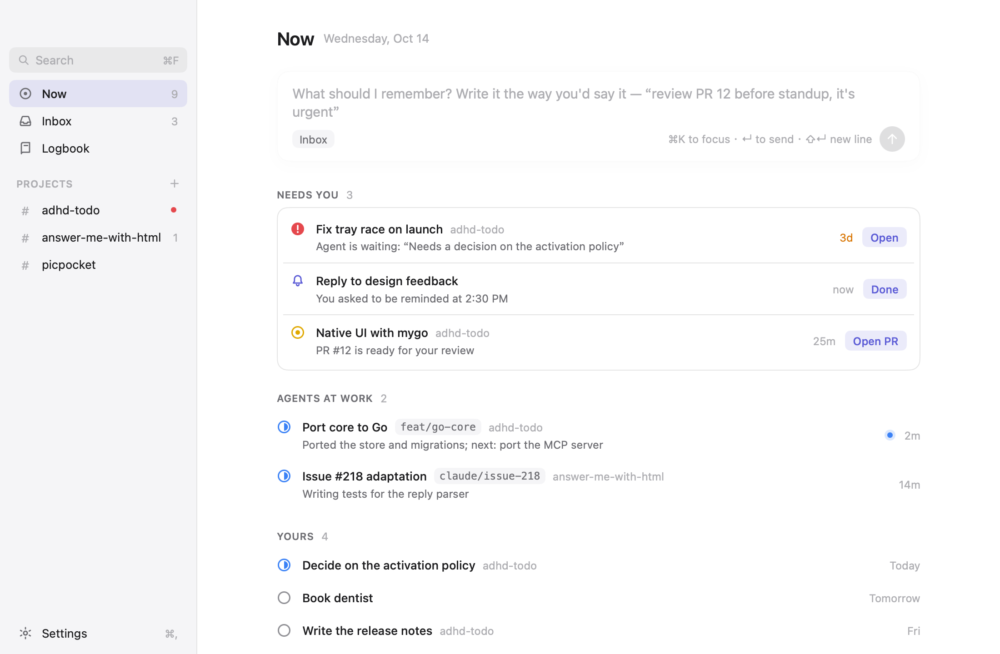
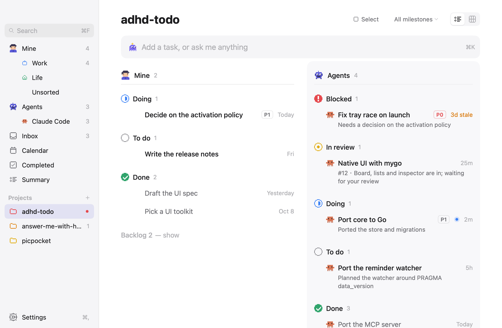

# Withdo

A todo app for people juggling many things at once. Coding agents (Claude Code first) report which
repo, branch and PR they are working on through a local MCP server, so you can see what every
agent is doing across parallel PRs. A native macOS app shows it live: one calm Now screen, then a
list per project. Everything is Go,
and the data is one local SQLite file.

<p>
  
  
</p>

More in [`docs/design/screens/`](docs/design/screens/); the design is specified in
[`docs/design/ui-spec.md`](docs/design/ui-spec.md).

## Install and update

Install the app once from the DMG of the [latest release](https://github.com/QingYunA/adhd-todo-releases/releases/latest)
(drag it to Applications; the app is not notarized, so open it the first time with right-click >
Open). Install a later version the same way. Automatic updates are built in but off for now
(`docs/plans/m10-auto-update.md`).

`withdo` is the app itself: on launch the app links `~/.local/bin/withdo`, where the MCP
registration below points, to its own executable, which runs as `withdo` under that name, so installing the app brings both. It leaves a build of your own
(one that is as new as the app's) alone. Coding agents keep running the old MCP server until you
restart them. Without the app, `withdo-cli-<version>-macos-universal.tar.gz` on the release is the
binary by itself. The product was called ADHD Todo before; the app moves the agent configs of that time
to `withdo` by itself, and `adhd-core` keeps working as an alias.

## Build

Requires Go 1.27.1 or newer (macOS for the app).

```sh
# the app: app/build/darwin-arm64/Withdo.app and a .dmg
cd app && go tool mygo build

# the CLI and MCP server
go build -o ~/.local/bin/withdo ./cmd/withdo
```

`scripts/build-release.sh` makes the release files of both platforms each release ships into
`app/build/release/`: for macOS the DMG of the universal app (which is `withdo` too) and the
standalone `withdo` tarball, plus the signed update archive when updates are on; for Windows x64
the installer, which carries the console `withdo.exe` next to the app. See `docs/plans/m10-auto-update.md`.

## Connect Claude Code

Register the MCP server once (user scope):

```sh
claude mcp add --scope user withdo -- ~/.local/bin/withdo mcp
```

On Windows use the command shown in Settings > Agents instead: it names the `withdo.exe` in the
install folder.

Other agents can add the server themselves: paste them the output of `withdo guide` (or use
Settings > Agents > Copy setup guide in the app).

Agents then report progress to the app. To see what they are doing from a terminal:

```sh
withdo overview
```

## Ask field (built-in assistant)

The ask field on the Now screen can understand what you type ("明天九点提醒我开会", "PR 12 merged,
close that task") and change tasks for you, with an Undo. It needs a model: open Settings > Models,
pick a provider (Anthropic, Magpie, OpenAI, DeepSeek, Kimi, OpenRouter, Ollama or any compatible
endpoint), paste its API key (stored in the system keychain) and press Test. Until then the field
just adds Inbox tasks. Provider choices live in `models.json` next to the database. To run the
optional live check: `ADHD_TODO_LIVE_MODEL=1 go test ./internal/agent -run TestLiveModel -v`.

## Data

The database is `~/Library/Application Support/adhd-todo/adhd-todo.db` on macOS
(`$XDG_DATA_HOME/adhd-todo/` on Linux, `%APPDATA%\adhd-todo\` on Windows). Set `ADHD_TODO_DB` to use
another file. The app and `withdo` share it; the app notices the other process's writes within
half a second.

## Develop

```sh
scripts/check.sh                                 # while working: gofmt, vet, i18n, short tests
scripts/check.sh full                            # before a PR: + race on the core (CI runs it as two jobs)
scripts/check.sh race                            # only the race tests
scripts/screens.sh                               # re-render the design screenshots; review them in the PR
git config core.hooksPath .githooks              # once: the static checks run on every commit
cd app && go tool mygo dev                       # run the app against the real database (.dev identifier)
go run ./app -fake                               # demo data instead of the database (-empty: none)
```

Layout: `cmd/withdo` (CLI), `internal/{paths,store,gitctx,domain,mcpserver,watch}` (core), `internal/{agent,providers}` (the built-in assistant),
`app/` (mygo UI: `data`, `theme`, `views`).


Contributing: see [CONTRIBUTING.md](CONTRIBUTING.md). Pull requests from outside need a signed [CLA](CLA.md).

## License

[AGPL-3.0](LICENSE). You may run, change and share the code; if you run a changed version as a
network service, you must offer its source to the people who use it. The name and the icon are not
covered by the license: a fork must use its own.
