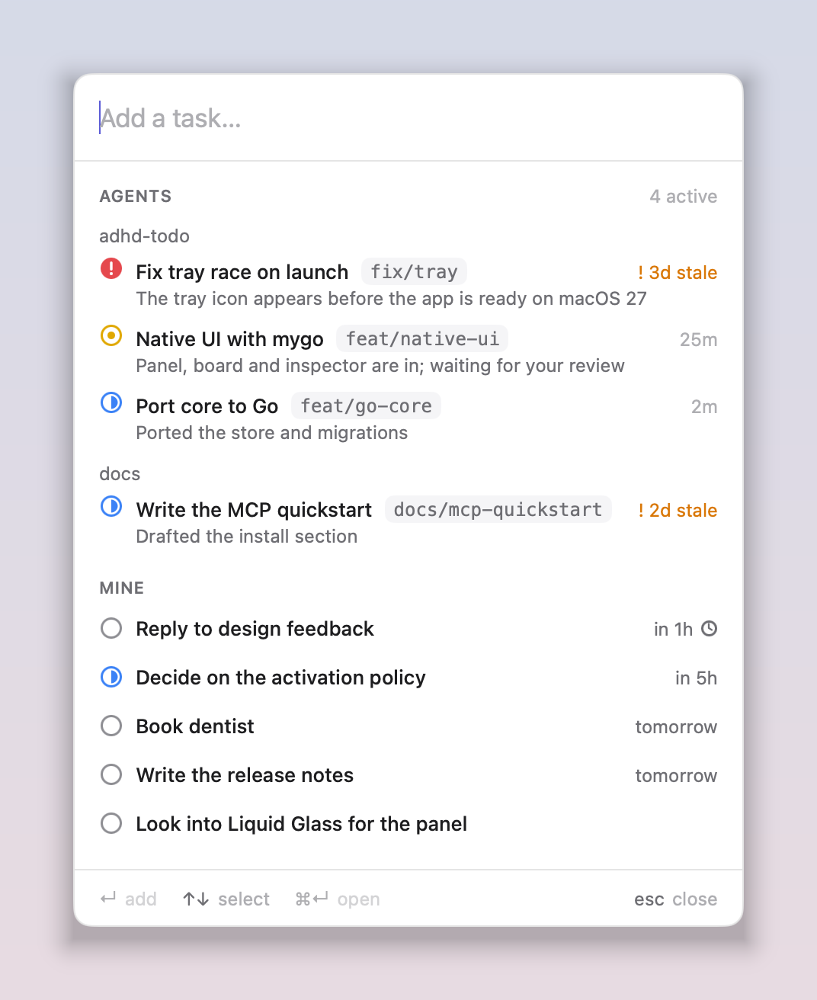
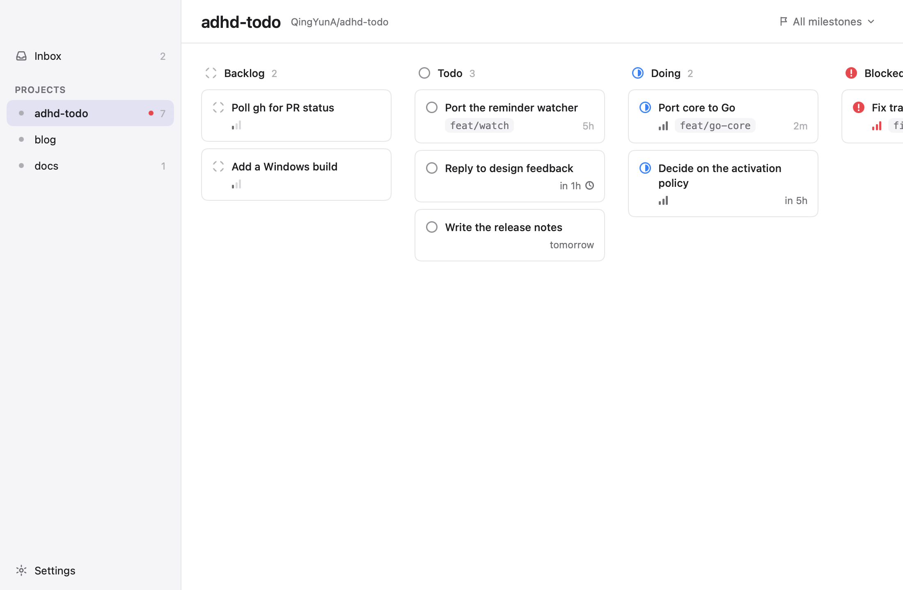

# adhd-todo

A todo app for people juggling many things at once. Coding agents (Claude Code first) report which
repo, branch and PR they are working on through a local MCP server, so you can see what every
agent is doing across parallel PRs. A native macOS menu bar app shows it live. Everything is Go,
and the data is one local SQLite file.

<p>
  
  
</p>

More in [`docs/design/screens/`](docs/design/screens/); the design is specified in
[`docs/design/ui-spec.md`](docs/design/ui-spec.md).

## Build

Requires Go 1.27.1 or newer (macOS for the app).

```sh
# the app: app/build/darwin-arm64/ADHD Todo.app and a .dmg
cd app && go tool mygo build

# the CLI and MCP server
go build -o ~/.local/bin/adhd-core ./cmd/adhd-core
```

## Connect Claude Code

Register the MCP server once (user scope):

```sh
claude mcp add --scope user adhd-todo -- ~/.local/bin/adhd-core mcp
```

Agents then report progress to the app. To see what they are doing from a terminal:

```sh
adhd-core overview
```

## Data

The database is `~/Library/Application Support/adhd-todo/adhd-todo.db` on macOS
(`$XDG_DATA_HOME/adhd-todo/` on Linux, `%APPDATA%\adhd-todo\` on Windows). Set `ADHD_TODO_DB` to use
another file. The app and `adhd-core` share it; the app notices the other process's writes within
half a second.

## Develop

```sh
go test -race -cover ./...                       # all packages
cd app && go tool mygo dev                       # run the app (add -- -fake for demo data, -- -empty for none)
SCREENS_OUT=$PWD/docs/design/screens go test ./app/...   # re-render the design screenshots
```

Layout: `cmd/adhd-core` (CLI), `internal/{paths,store,gitctx,domain,mcpserver,watch}` (core),
`app/` (mygo UI: `data`, `theme`, `views`).

