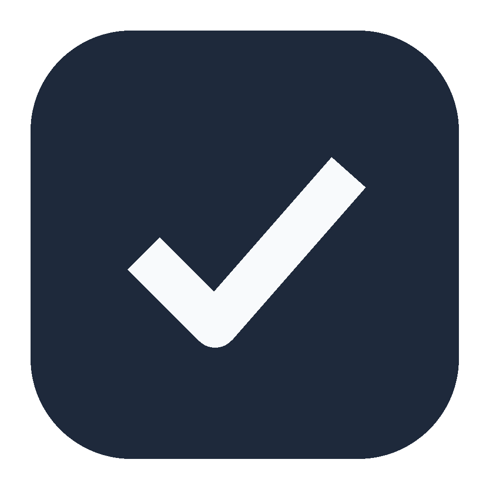
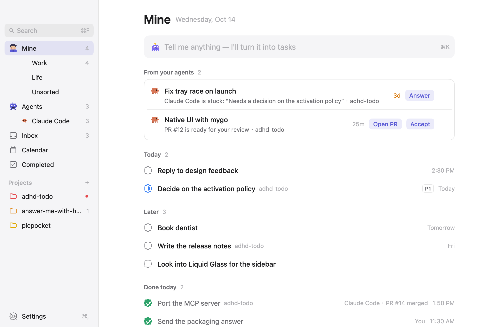
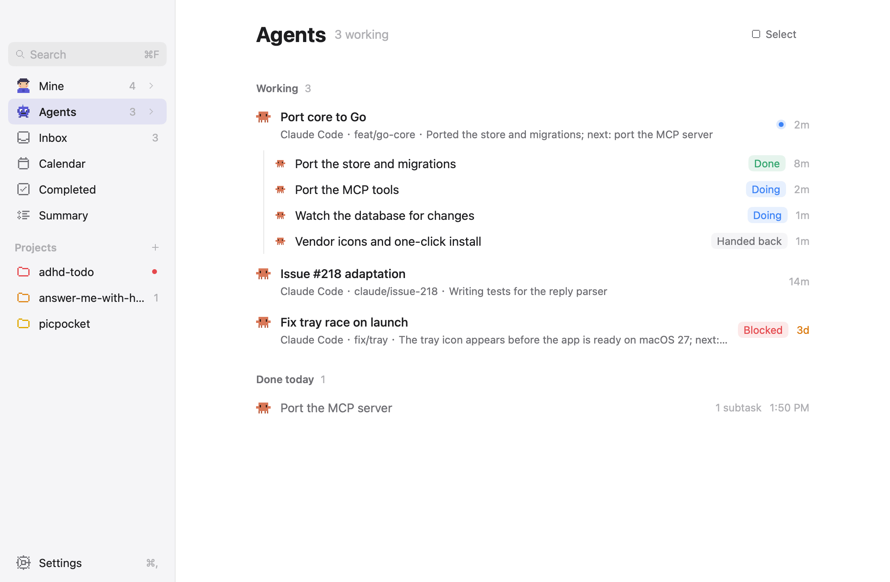

<p align="center"></p>
<h1 align="center">Withdo</h1>
<p align="center"><b>A todo app for you and your coding agents.<br>Agents report the repo, branch and PR they work on; you see all of it next to your own tasks.<br>Connects to 14 coding agents from one settings page.</b></p>
<p align="center">
  <a href="https://github.com/QingYunA/withdo/releases/latest"></a>
  
  <a href="https://github.com/QingYunA/withdo/stargazers"></a>
</p>
<p align="center"><a href="https://adhd-todo.sri-ai.xyz/"><b>Website</b></a> · <a href="#download">Download</a> · <a href="#connect-your-agents">Connect your agents</a> · <a href="docs/design/ui-spec.md">Design spec</a> · <a href="CONTRIBUTING.md">Contributing</a></p>

<p align="center">
  
  
</p>

- **One place for parallel work.** Each agent reports through a local MCP server: what it is doing, where it is stuck, which PR it opened. Today shows those cards beside your own tasks.
- **Hand a task to an agent.** Drag a task onto the Agents tray: it waits for an agent. Nothing starts by itself; tell your agent the task number ("do #44") and its reports show up on that row.
- **Type or say it.** The input at the top reads "明天九点提醒我开会" into a task with a reminder. With your own model it also does things like "PR 12 merged, close that task", with an Undo. Voice input needs an account.
- **Local first.** Your tasks live in a SQLite file on your machine. Signing in adds sync with your other computers and the Android app.

More screens are in [`docs/design/screens/`](docs/design/screens/).

## Download

| Platform | File on the [latest release](https://github.com/QingYunA/withdo/releases/latest) |
| :--- | :--- |
| **macOS** (Apple silicon and Intel) | `Withdo-<version>-macos-universal.dmg` |
| **Windows** (x64) | `Withdo-Setup-<version>-windows-x64.exe` |
| **Android** | `adhd-todo-<version>.apk` |

On a Mac, drag Withdo to Applications. The app is not notarized, so macOS blocks the first launch:
open it once, then choose Open Anyway in System Settings > Privacy & Security (before macOS 15,
right-click > Open). After that it updates itself; the Android app shows a banner when a new
version is out.

Installing the app also installs the command line. On launch the Mac app links
`~/.local/bin/withdo` to itself; add `~/.local/bin` to your `PATH` to type `withdo`. The Windows
installer puts `withdo-cli.exe` next to the app; run it from the install folder with the same
arguments. For a machine without the app, `withdo-cli-<version>-macos-universal.tar.gz` is the
command line alone.

The app was called ADHD Todo before 0.11.0. It moves the agent configs of that time to `withdo` by
itself, and `adhd-core` keeps working as an alias.

## Connect your agents

Open Settings > Agents: it finds the coding agents on your computer, and one click on an agent adds
the MCP server to it. Claude Code, Codex, Cursor, Gemini CLI, Copilot (VS Code), Windsurf and eight
more are supported.

By hand, for Claude Code:

```sh
claude mcp add --scope user withdo -- ~/.local/bin/withdo mcp
```

On Windows use the command shown in Settings > Agents instead: it names the `withdo-cli.exe` in the
install folder (on Windows, run `withdo-cli.exe` wherever this page says `withdo`). Any other agent
can add the server itself: paste it the output of `withdo guide` (or Settings > Agents > Copy setup
guide).

Restart an agent after you connect it, and after every update: an agent keeps running the old MCP
server until it restarts. To see what your agents are doing from a terminal:

```sh
withdo overview
```

## The input box

Without a model, the input adds what you type as tasks and reads dates and times itself ("明天",
"next friday 9am"), on your machine. To let it change tasks for you, open Settings > Advanced > Use
your own model and pick a provider: Anthropic, OpenAI, Gemini, DeepSeek, Kimi, GLM (智谱), Qwen
(通义千问), OpenRouter, SiliconFlow (硅基流动), a local Ollama or Magpie gateway, or any compatible
endpoint. Paste its API key where it
asks for one; the key is stored in the system keychain. Provider choices live in `models.json` next
to the database.

## Data

The database is `~/Library/Application Support/adhd-todo/adhd-todo.db` on macOS
(`%APPDATA%\adhd-todo\` on Windows, `$XDG_DATA_HOME/adhd-todo/` for a CLI built on Linux). Pictures
and settings sit beside it in the same folder. Set `ADHD_TODO_DB` to use another file. The app and
`withdo` share it; the app checks for the other process's writes every half second. The folder
keeps the old name so that installs from before the rename keep their data.

The sync server is in this repository too (`internal/syncserver`, deployed with `deploy/sync/`).
`withdo sync` links a machine without the app to it.

## Build

Requires Go 1.27.1 or newer (macOS for the app).

```sh
# the app: app/build/darwin-arm64/Withdo.app and a .dmg
cd app && go tool mygo build

# the CLI and MCP server
go build -o ~/.local/bin/withdo ./cmd/withdo
```

`scripts/build-release.sh` builds the release files of macOS and Windows into `app/build/release/`,
and `scripts/android-release.sh` the APK. The release steps are in
[`docs/plans/m10-auto-update.md`](docs/plans/m10-auto-update.md#release-steps-for-the-release-pr).

## Develop

```sh
scripts/check.sh                                 # while working: gofmt, vet, i18n, short tests
scripts/check.sh full                            # before a PR: + race on the core and the sync tests (needs the Postgres the script names)
scripts/check.sh android                         # Android unit tests and lint (JDK 17)
scripts/screens.sh                               # re-render the design screenshots; review them in the PR
git config core.hooksPath .githooks              # once: the static checks run on every commit
cd app && go tool mygo dev                       # run the app against the real database (.dev identifier)
go run ./app -fake                               # demo data instead of the database (-empty: none)
```

Layout: `cmd/withdo` (CLI), `internal/{paths,store,gitctx,domain,mcpserver,watch}` (core),
`internal/{agent,providers}` (the built-in assistant), `app/` (mygo UI: `data`, `theme`, `views`),
`android/` (the Android app), `internal/syncserver` (sync).

To contribute, read [CONTRIBUTING.md](CONTRIBUTING.md). Pull requests from outside need a signed
[CLA](CLA.md).

## License

[AGPL-3.0](LICENSE). You may run, change and share the code; if you run a changed version as a
network service, you must offer its source to the people who use it. If you publish a fork, please
give it its own name and icon.
