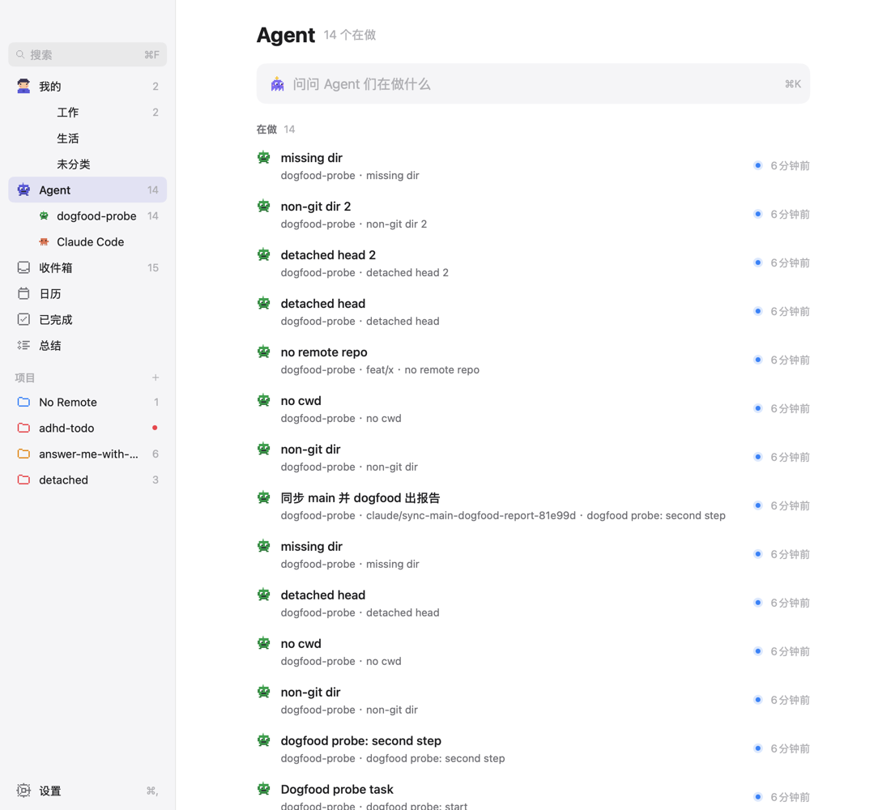
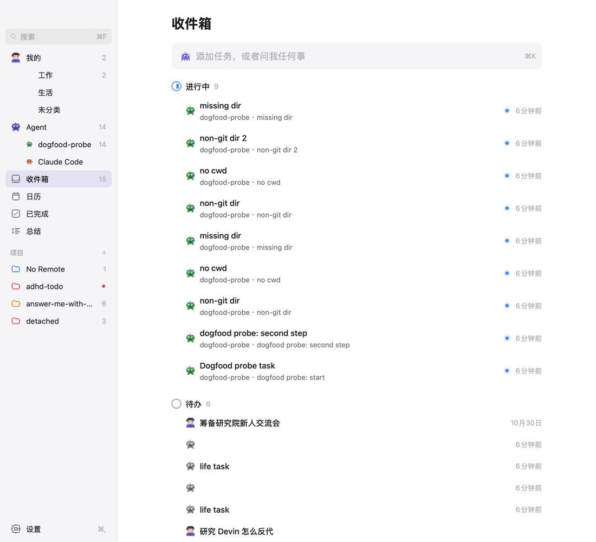
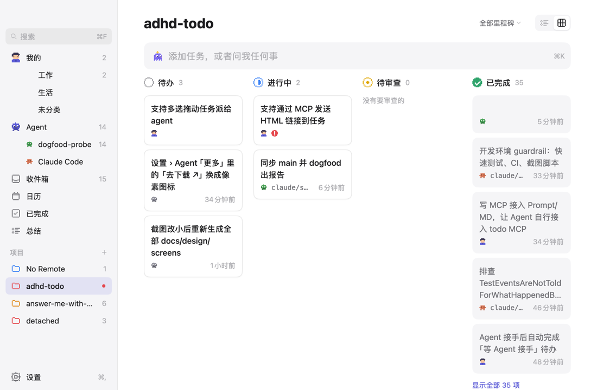
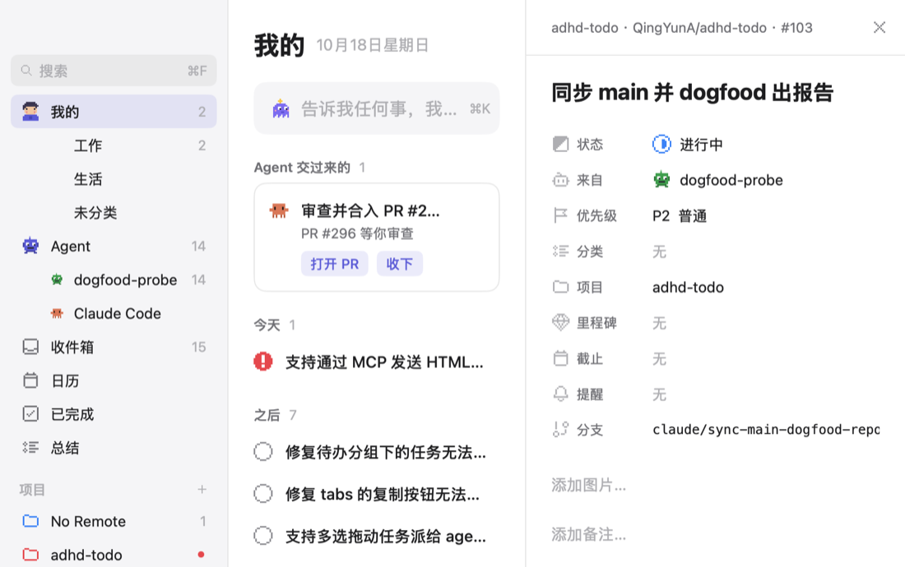

# Dogfood report, 2026-10-18

Build: `main` at `d49f33d` (v0.3.0), Go 1.27.1, macOS arm64. Everything ran against a copy of the
real database (`sqlite3 .backup` into `/tmp/adhd-dogfood/adhd-todo.db`, passed as `ADHD_TODO_DB`),
so the real data was never written to.

## What was covered

| Area | How | Result |
| --- | --- | --- |
| Checks | `scripts/check.sh full` | All pass, about 2 min |
| CLI | `overview`, `guide`, unknown commands, empty and unwritable database paths | Works; two small papercuts |
| MCP | A stdio JSON-RPC client calling all 8 tools: worktree, repo without remote, detached HEAD, non-git and missing `cwd`, no `cwd`, bad enums, unknown ids, bad dates and URLs, blank titles | Validation mostly good; see findings |
| Live updates | The app's `data.Real` watching while a separate `adhd-core mcp` process wrote a report | Noticed in 494 ms; the task showed on Agents |
| UI | Mine, Agents, Inbox, Completed, Calendar, Summary (day, week), every project as list and board, Inspector (wide and 860 × 540), Settings panes, the ask field with no model; Chinese, light and dark | Rendered off-screen through `ui.Tester` over the real adapter, in the way of `TestScreensRealShape` |

Driving the real window did not work out: System Events clicks don't reach the mygo views and the
display went to sleep partway through, so the UI pass used the off-screen renderer instead. A pass on the real window is
still worth doing for motion, notifications and drag and drop.

## Findings

### P2: a report with no branch makes a new task every time

`report_progress` finds the task by repo and branch. With no branch (a detached HEAD, a `cwd`
outside git, a `cwd` that does not exist, or no `cwd` while the server runs outside a repo), every call without
`task_id` creates another task.

1. Clone any repo and `git checkout --detach`.
2. Call `report_progress {cwd: <clone>, summary: "a"}`, then again with `summary: "b"`.
3. Two tasks (`#115`, `#116`) now sit in the project, both `doing`.

Expected: the second report lands on the first task, or the reply says so plainly. The reply text
is only `Created #115 [doing] P2 — detached head`, so an agent that does not read
`structuredContent.task_id` has no hint to pass `task_id` next time. In this run 14 duplicate
`doing` tasks piled up on Agents and in the Inbox:

Suggestion: when no branch was found, end the reply with "No branch here: pass task_id 115 on
your next reports", and say the same in the server instructions.

### P2: whitespace-only titles are accepted

`create_task {title: "   "}` and `update_task {title: "   "}` both succeed. The checks in
`internal/domain/tasks.go` (`withDefaults`, `applyPatch`) compare with `""`, while
`ReportProgress` already uses `strings.TrimSpace` for the summary, and the ask field ignores blank
input. The result is rows with only an avatar in the Inbox, an empty card on the board, and a blank
line in Completed and Summary:

### P3: a `cwd` that does not exist is accepted silently

`report_progress {cwd: "/tmp/does-not-exist", ...}` creates an Inbox task. A typo in `cwd` should
be an error ("cwd: no such directory"), not a task with no project.

### P3: dates without an offset are rejected

`remind_at: "2026-10-19T09:00"` fails with "must be an ISO 8601 date or datetime with offset".
The message is clear, but agents often send local times without an offset. Reading them as local
time would save a round trip.

### P3: raw schema errors reach the agent

A wrong type comes back as
`validating "arguments": validating root: validating /properties/task_id: type: <invalid reflect.Value> has type "null", want "integer"`.
The domain errors (`pr_url: must be an absolute URL, e.g. …`) read much better; the schema ones
could be reworded to `task_id: must be an integer`.

### P3: the Inspector clips the branch without an ellipsis

At 860 × 540 the Branch value is cut mid-word (`claude/sync-main-dogfood-repo`). Everything else
long in the app is ellipsized.

### P3: smaller papercuts

- **Title repeated under itself.** A task created by its first report takes the summary as its
  title, so its row reads `missing dir` over `dogfood-probe · missing dir`.
- **UTC times in `overview`.** The CLI prints `2026-10-18T03:55:24.502Z` for a report made at 11:55
  local time. The same text goes to agents through `get_overview`, where UTC is fine; the CLI could
  print local times.
- **`adhd-core help`** is an unknown command (`--help` and `-h` work), and `adhd-core overview --help`
  ignores the flag and prints the overview.
- **A warning on every launch.** `WARNING: sonic/ast only supports (go1.17~1.26 …)` goes to stderr at
  startup on Go 1.27. It comes from `github.com/bytedance/sonic` through `cloudwego/eino/adk`
  (`internal/agent`). It is harmless (sonic falls back to `encoding/json`), but it is noise in
  logs.

## Questions, not bugs

- **"From" follows the latest reporter.** `#103` was created by Claude Code; after another client
  (`dogfood-probe`) reported on the same branch, the Inspector, the board and the Agents page all
  show `dogfood-probe`. Fine if "who is on it now" is the intent.
- **An agent's life task goes to the Inbox.** `create_task {category: "life"}` with no project lands in
  the Inbox, and `Mine > Life` stays empty. Mine seems to be the user's own tasks only; worth
  checking that this is what the user expects.
- **A worktree name as a project.** Settings > General lists the archived project
  `adhd-todo-mcp-visibility-018c09`, named after a worktree directory and without a repo slug.
  It looks left over from before worktrees resolved to their repo; nothing new creates it.

## What worked well

- The checks are green and fast enough to run before every PR.
- `adhd-core guide` reads well and an agent can follow it as written: config entry, install order,
  backup step, a check to verify.
- Branch matching in a worktree and in a repo without a remote did the right thing: repeated
  reports landed on one task.
- Validation of enums, ids, URLs, slugs and dates is in place, and the domain messages give an
  example of what is expected.
- The watcher picked up a write from another process in under half a second, as the README says.
- Agents that are not Claude Code show up as their own row with their own sprite, as soon as they
  report.
- The Summary page, the board and the Chinese layout render cleanly on real data, in light and dark.
