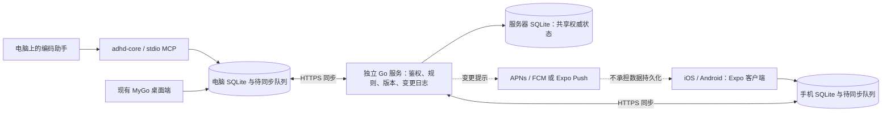

# Android / iOS 独立客户端调研

调研日期：2026-10-16。代码基线：`6607f4751703588cbe99a47906561e8b99b9943a`，即 v0.2.0。

用户明确要求：**电脑关机后仍能使用手机端，支持离线编辑和多设备同步。** 本文是实施建议，未创建手机工程、部署服务或申请开发者账号。

后续决策：云青已确认 Expo / React Native development build 路线。[实施计划](m7-mobile.md)已单独整理，后续执行以该计划为准；本文保留调研证据与备选路线。

## 结论

推荐 **Expo / React Native 手机客户端 + 每台设备本地 SQLite + 独立 Go 同步服务**。Android 和 iOS 共用手机端代码；现有 macOS / Windows 继续使用 MyGo。现有 Go 领域逻辑优先复用到服务器，不把 gomobile 桥接作为首版前提。

这是基于现有代码结构的工程判断：我们没有可直接套壳的 HTML 前端；官方 MyGo 不维护 iOS / Android；现有 Go Core 已经集中处理任务和事务，但还没有跨设备同步。先把可靠同步做出来，比把手机绑在实验性 MyGo fork 上更符合当前目标。[S1][S2][R1][R2]

默认按“单用户、多设备、自用优先”估算；不预做团队协作和多租户。手机可独立管理任务，AI 调用仍需要网络；电脑关闭时，Agent 进度只能显示最后同步的记录，不能凭空产生新进度。GitHub 状态若也要在电脑关闭时更新，需要服务器独立接入 GitHub API 或 webhook。

## 1. 手机框架怎么选

| 路线 | Android / iOS | 现有 MyGo UI 复用 | Go 逻辑复用方式 | 判断 |
| --- | --- | --- | --- | --- |
| Expo / React Native | 官方支持两端 | 不能直接复用，需手机 UI | 首版在 Go 服务端复用；本地绑定可另做实验 | **首选**：SQLite、凭据、通知、图片、构建分发有现成接口 |
| Flutter | 官方支持两端 | 需重写为 Dart UI | Go 服务端，或额外 FFI / 平台桥接 | 可行备选；若团队更熟 Dart，可调整选择 |
| Capacitor | 官方支持两端 | 没有现成 Web UI 可套壳 | Go 服务端，或自定义原生插件 | 当前收益有限；需新写 Web UI，并选择可靠 SQLite 插件 |
| MyGo 社区 iOS fork | iOS 有实验实现；Android 待实现 | iOS 有机会复用 Go widgets | 本地 Go | 不适合作为两端交付主线；需要自行维护底层框架 |
| Gio / Fyne | 有手机构建路径 | 都需要重写 UI | 本地 Go | Go 优先时的候选；输入法、通知、后台、无障碍仍需 PoC |
| SwiftUI + Kotlin / Compose | 两套官方原生路线 | 需分别重写 | HTTP Go 后端，或 gomobile facade | 能做，但两套 UI 与平台代码增加维护面 |

Expo 不是因为项目已经有 React 资产而胜出——当前没有。选择依据是两端平台集成和构建工具覆盖较完整。Flutter 同样成立；最终应通过同一个离线任务与中文输入 PoC 验收，不能只比较文档。[S3][S4][S5][S6][S7][S8]

MyGo fork 的 iOS 实现包含触摸、输入法、Keychain、通知和打包工具，不能简单说“没人做过”。但上游 PR #157 已关闭且未合并，作者明确表示不想维护 iOS / Android；fork 文档仍将 Android native UI 标为待实现。采用它意味着 Android 后端和后续兼容性要由我们承担。[S1][S2]

## 2. 现有项目能复用什么

| 现有部分 | 处理方式 | 依据 |
| --- | --- | --- |
| `internal/domain` 任务、子任务、项目、里程碑、报告与校验 | 在 Go 服务端复用，补充同步身份与并发语义 | Core 已集中组织写事务；并非与存储完全解耦的纯函数库 [R1] |
| `internal/store` SQLite 与迁移 | 桌面保留；首个单用户服务器也可使用 SQLite | 现有 SQL 依赖 SQLite；不需为首版立即迁移 PostgreSQL [R2] |
| `internal/mcpserver`、CLI | 保留在运行编码助手的电脑上 | 当前是 stdio MCP；不会自动成为手机接口 [R3] |
| `app/views`、MyGo shell | 桌面保留；手机重写导航和布局 | Go 原生 UI，不是 React 或 HTML [R4] |
| `app/data` 类型、筛选、Mine / Agents 规则 | 作为语义规格与样例；按需要移到 Go 服务端或映射到手机 | 不应让桌面 DTO 直接变成同步协议 [R4] |
| `gitctx`、`ghpoll`、安装 Agent MCP | 留在电脑；需要时将 GitHub 查询另外放到服务器 | 依赖本地仓库、`git`、`gh`、桌面配置文件 [R5] |
| 模型设置与 API key | 手机使用 Keychain / Keystore；服务器独立管理其凭据 | 不能直接把当前 keyring 换成一个会同步的文本字段 [R6][S9] |

目前同一 SQLite 会被桌面应用和多个 `adhd-core mcp` 进程写入。变更捕获必须进入公共写事务；只在手机 UI 或桌面按钮里加入同步，会漏掉 Agent 写入。[R1][R2][R3]

`repo_path`、本地 worktree 路径是设备信息。跨设备传递项目身份、分支与 PR 引用，服务器不应尝试在手机或云主机上执行电脑传来的 `cwd`。云端调用领域逻辑时，需要一个不依赖本地 git 的输入路径。[R5]

## 3. 独立端的架构

所有客户端先读写本地数据库，UI 不等服务器。服务器负责跨设备已确认状态；它不能决定本地编辑是否先保存。网络断开或凭据过期时，编辑仍保留在队列中，待网络和身份恢复后再提交。

服务器需要常驻于电脑之外，可部署在自有机器或云端。桌面保留本地 SQLite 与离线能力；不要把它改成每次点击都必须联网。

首版服务器可采用一个用户一个部署实例，避免把目前没有用户隔离字段的 SQL 直接暴露为公共多租户服务。仍然需要 HTTPS、身份验证、设备撤销、持久化磁盘与可恢复备份。身份系统优先用现成方案；具体账号与部署环境在实施时选择。

### 一次离线编辑如何完成

1. 手机在同一 SQLite 事务中保存任务编辑和待同步操作；事务成功后 UI 显示已保存。
2. 联网后上传带唯一 `mutation_id` 的操作；服务器在事务中校验、写业务数据并写变更日志。
3. 服务器确认后，客户端处理回执，再根据服务端游标拉取其他设备的变更。
4. 应用服务器数据与推进游标必须放在同一事务；已确认快照和本地待提交编辑需要分开管理。
5. 请求已生效但回执丢失时，用原 `mutation_id` 重试；服务器返回原结果，不重复创建。
6. 冲突进入可见的待处理状态，保留用户原编辑；不能因下载服务器快照而覆盖未上传内容。

以上是拟议协议，不是已有能力。SQLite 事务和 Expo 的持久化接口可以支撑第 1 步，但不自动提供第 2–6 步。[R2][S10]

## 4. 同步设计必须先解决的事

| 问题 | 首版建议 | 现状与风险 |
| --- | --- | --- |
| 两台设备都创建了 `task 42` | 保留本地整数 ID，增加全局 `sync_id`；外部关系使用全局 ID | 现有表是本地 `INTEGER PRIMARY KEY`，不能当全球身份 [R7] |
| 离线创建项目、父任务、子任务 | 操作包含依赖关系，服务器按事务 / 有序批次应用并返回映射 | 不能先同步子任务，导致父任务不存在 |
| 编辑之后程序崩溃 | 业务写入与 outbox 必须同事务；下载与游标推进也同事务 | 数据保存成功而队列漏写，会形成永久不同步 |
| 重试、重复 Agent 报告 | 幂等操作 ID、稳定报告 ID、持久化处理回执 | 时间戳不是去重键 |
| 设备时钟不同 | 使用服务端单调序列作增量游标；业务时间保留原含义 | `updated_at` 会重复且受时钟影响，不能独自作同步协议 |
| 手机改标题，电脑同时改状态 | 首版使用版本检查和明确冲突反馈；报告采用追加流 | 不默认用整行最后写入覆盖所有字段；后续可做不相交字段合并 |
| 手机完成任务后，旧 Agent 状态才上传 | 明确状态迁移和来源优先规则；旧报告可追加，状态冲突单独处理 | “报告更新”不应无提示覆盖用户刚完成的任务；需要定义并测试 |
| 删除和 Undo | 持久化 tombstone；删除整棵关系和恢复要有明确版本 | 现有物理删除与本地快照恢复，无法让离线设备知道已删除 [R8] |
| 一台设备离线很久 | 游标保留期、过期后的全量快照重建、tombstone 回收规则 | 删除标记不能在离线设备回来前无条件清除 |
| `reminded_at` / 已读进度 | 提醒配置共享，投递记录按设备；已读语义单独定义 | 直接同步单个投递标记可能让其他设备漏提醒；`seen.json` 目前也在数据库之外 [R9] |
| 老客户端或老 MCP 进程 | 同步协议与数据库迁移做兼容性检查；桌面和 CLI 协调升级 | 不能让旧程序静默写入新结构后漏记变更 |

第一版不必引入通用 CRDT 或协同文档编辑。先采用保守的版本检查，提供保留本地 / 采用远端 / 重新编辑的冲突处理。Agent 报告是追加记录，可以减少整行覆盖；任务状态与删除仍需显式规则。这是推荐的复杂度取舍，尚未实现。

不要用 iCloud Drive、网盘或 Syncthing 直接同步运行中的 SQLite 文件来替代协议。SQLite 官方明确 WAL 的并发进程要求在同一台主机；文件复制与跨设备业务冲突是另一回事。[S11]

### 自建协议还是现成同步引擎

| 选择 | 优点 | 对本项目的实际代价 |
| --- | --- | --- |
| **受限业务协议 + Go / SQLite** | 复用当前 Core 与 SQL；桌面、MCP、手机遵循同一业务协议 | 我们负责幂等、冲突、游标、删除、恢复；必须先通过故障测试，不能把它当几条 CRUD 接口 |
| PowerSync + 支持的云数据库 | 手机端已有 SQLite、上传队列、下载同步和重试；支持 RN / Expo，可自托管 | 当前文档的源数据库不包含 SQLite；官方 SDK 目录未列 Go。现有 Go SQLite Core 与桌面同步仍需适配，写入授权和业务校验也仍由我们的后端负责 [S12] |
| Firestore | Android / Apple / Web 有离线持久化与自动同步 | 需重构当前 SQLite 数据层和桌面同步；官方同文档冲突是 last-write-wins，不等于我们需要的状态语义 [S13] |

针对当前单用户产品，首选有限范围的 Go 同步协议；**若范围扩大到多人协作，应先重新评估 PowerSync 等成熟同步引擎，不能默认无限扩展自研方案**。阶段 0 应对比一次 PowerSync 纵向样例，核算是否值得迁移云端存储，而不是仅凭框架偏好排除它。

## 5. 手机功能与后台行为

首版独立端包含：Mine / Agents 最近状态、任务增删改与完成、子任务、项目列表、到期日、基础日历、离线缓存与队列、冲突入口、提醒、账户与同步状态。手机采用底部导航与任务详情页，不照搬桌面侧栏和多窗口。

模型管理、图片问答、完整看板、复杂项目管理可以分阶段补齐；离线新增和修改任务不依赖 LLM。若首版加入联网助手，让它复用 Go 服务器上的领域操作即可，不必把整套 Eino / 模型 SDK 嵌进手机。服务器代理模型和手机直连模型的凭据归属，需要分别设计。

- **本地提醒**：手机已知的提醒提前注册到系统；修改或完成任务时取消 / 替换。需测试通知权限、Android 精确闹钟权限、重启和时区变化。[S14]
- **远端变更**：服务器发送推送作为提示；打开应用或恢复网络时拉取真实数据。推送不是可靠消息队列，也不是同步成功回执。[S15]
- **后台同步**：Android WorkManager 的最短间隔为 15 分钟；iOS 由系统调度。不能承诺锁屏后每几秒持续轮询，或用户强制退出后仍实时运行。[S16]
- **无法避免的离线差异**：手机离线期间不知道另一台设备刚取消的提醒，可能仍展示旧提醒；同步后必须撤销过期排程。不能把这种情况描述为所有设备通知严格一次。
- **电脑关闭**：手机仍可独立编辑和联网访问服务器；停止的 Agent 不再产生进度。需要持续 GitHub 更新时，由服务器接入 GitHub，不能要求手机运行 `gh`。

## 6. 实际探测结果与验证边界

以下命令使用当前 Go 1.27.1、MyGo v0.5.1、modernc.org/sqlite v1.60.1；没有安装移动 SDK，也没有打开浏览器。

| 检查 | 结果 | 能证明什么 |
| --- | --- | --- |
| `GOOS=android GOARCH=arm64 CGO_ENABLED=0 go build ./internal/domain` | 退出码 0 | 当前 Go 业务包及其 SQLite 依赖可以生成 Android 目标代码 |
| `GOOS=ios GOARCH=arm64 CGO_ENABLED=0 go build ./internal/domain` | 退出码 0 | 当前 Go 业务包及其 SQLite 依赖可以生成 iOS 目标代码 |
| 对 `modernc.org/sqlite` 单独执行上述两个目标构建 | 均退出码 0 | 不能把 SQLite 简单认定为手机编译阻塞；官方平台表未承诺这些目标，仍需真机验证 [S23] |
| 在 `app/` 执行 `go tool mygo build -platform web -o ../dist/mobile-research/web-probe` | 失败 | 当前整套应用不能直接转成 Web：`modernc.org/libc/errno` 等依赖排除 js/wasm，PWA 也需要改数据实现 |
| 本机 `xcodebuild -version` | 缺少完整 Xcode，仅装 Command Line Tools | 当前机器不能直接做本地 iOS 原生构建 |
| `java -version`、常见 Android SDK 目录 | 无 Java Runtime，检查目录中未见 Android SDK | 本地 Android 工具链尚未就绪；未排查其他自定义目录 |

编译业务包不等于生成可安装手机应用，不证明 gomobile 绑定、iOS 链接、SQLite WAL / 锁 / 文件保护、后台恢复或真机输入法可用。没有进行模拟器、真机、耗电、包体或性能测试。

如果坚持 Go 运行在手机内，额外做一个窄的公开 facade：例如 JSON 字符串 / 字节数据与明确的取消句柄。现有 Core 的 `context.Context`、指针结构体、数据库和 git 依赖不适合直接当 gomobile 绑定表面。即便这样可行，手机 UI 和同步协议仍然需要实现。[S17][R1]

## 7. 实施阶段与验收

以下时间是**一名熟悉仓库的工程师的粗估**，不是实测或交付承诺；不含账号审核、硬件采购与商店审查等待。

| 阶段 | 产出 | 验收条件 | 粗估 |
| --- | --- | --- | --- |
| 0. 验证路线 | Expo 真机小样、Go 同步最小纵向样例；对照 PowerSync 接入成本 | Android 与 iPhone 都能安装；离线创建、杀进程重开仍存在；联网后两台收敛，重复上传不重复创建 | 2–4 个工作日 |
| 1. 数据与同步基础 | 全局 ID、版本、outbox、服务端日志、认证、快照与恢复 | 双设备同时创建、编辑、删除，含父子关系；掉线 / 丢回执 / 游标重放 / 进程崩溃可恢复 | 1.5–2.5 周 |
| 2. 手机核心流程 | Mine / Agents、任务详情、项目、日历、提醒与同步状态 | 中文输入、键盘避让、无障碍基础、离线 CRUD、冲突保留、权限拒绝均可用 | 1.5–2.5 周 |
| 3. 桌面与 MCP 接入 | 现有桌面和所有 MCP 写入进入同步 | 多个 MCP 进程写入不丢变更；桌面离线可用；旧数据库升级可恢复 | 1–2 周 |
| 4. 发布与加固 | 签名 APK / AAB、TestFlight、备份恢复与升级记录 | 真机弱网、长时间离线、时区、后台 / 强制退出、升级、重新登录、已确认数据恢复通过 | 1–2 周 |

总体按 **6–10 周**规划比较合理；阶段间可有重叠，仍需以阶段 0 的结果重新估算。已有原型或使用成熟同步引擎可能缩短部分工作，现有同步缺失也可能让冲突与迁移测试超出估算。

最关键的验收例子：**电脑关闭，手机 A 飞行模式下创建父任务和子任务并修改状态；杀进程后重开；手机 B 同时在线编辑；A 恢复网络后，两台最终收敛，冲突有提示，报告不重复，删除不复活，未上传编辑不丢失。** 先通过这条，再扩展桌面功能覆盖面。

### 建议的代码落点（拟议，尚未创建）

- `mobile/`：Expo / TypeScript 工程，用 pnpm；本地 SQLite、手机 UI、通知与凭据。
- `internal/syncproto/`：版本化的跨端数据和命令协议，避免把数据库行直接当公共接口。
- `internal/sync/`：桌面端同步状态机、事务变更捕获与离线队列。
- `cmd/adhd-sync/`：独立运行的 Go 服务；复用 domain，处理认证、版本、日志与快照。
- 当前 schema 迁移：增加同步身份和元数据，处理已有数据导入；保留数据库备份与版本检查。

这只是职责划分，不要求在 PoC 前一次性建立全部抽象。先串通创建任务、同步和重试，再按真实依赖拆分。

## 8. 打包发布条件与当前阻塞

| 项目 | 条件 / 费用 | 是否阻塞当前调研 |
| --- | --- | --- |
| iOS 本地开发 | 完整 Xcode、适配的 iOS SDK / Simulator；最终需 iPhone 验收 | 不阻塞调研；当前本机缺完整 Xcode |
| Android 本地开发 | JDK、Android SDK / 构建工具；最终需 Android 真机验收 | 不阻塞调研；当前探测未就绪 |
| 云构建 | EAS 可托管 Android / iOS 构建，也可不用 EAS 自建 CI；额度与价格按当时计划核算 | 可绕开本机打包工具缺失，不替代真机验收 [S18] |
| iOS TestFlight / App Store | Apple Developer Program，官方 99 USD / 年，地区定价可能不同 | 分发前需确认账号；是否已有账号本次未查询 [S19] |
| Google Play | 官方 25 USD 一次性注册费 | APK 测试与商店正式发布区分处理 [S20] |
| 新个人 Play 账号 | 2023-11-13 后新建的个人账号，生产访问通常需 12 名测试者连续参加封闭测试 14 天 | 是否适用需查实际账号，满足后还需申请生产访问 [S21] |
| APK 直接测试分发 | 仍需签名并核实目标地区、设备的开发者验证要求 | 不能泛称 APK 可绕过所有注册；Android 当前有分地区验证安排 [S22] |
| 独立同步服务 | 电脑之外的常驻服务、持久化存储、认证、备份 | 这是产品独立运行的实际依赖，当前仓库尚无此服务 |

Android 目前的官方开发者验证页面列出 2026-09-30 起在部分地区的保护安排，以及最多 20 台设备的 limited distribution 路径。分发方式、账号条件和目标地区应在执行前再次核对；不要沿用旧的“直接发 APK 就一定无需注册”说法。[S22]

首个可分发结果应是 Android 测试 APK 与 iOS TestFlight。正式双商店发布是后续验收结果；不能把生成 APK / IPA 当作用户已经能安装。

## 来源

外部事实均来自官方文档、源码或仓库作者记录，访问日期为 2026-10-16。工程建议、时间估计及待做的验收均已在正文标明。

- [S1 MyGo PR #157 与作者不维护手机端的说明](https://github.com/egoist/mygo/pull/157#issuecomment-6063683750)
- [S2 社区 fork iOS 文档](https://github.com/daodao97/mygo/blob/feat/ios-platform/docs/ios.md)；调研分支提交 `bc60b9d5023152e95e56483becefb43a7664bb05`。
- [S3 Expo 官方文档](https://docs.expo.dev/)
- [S4 Flutter 支持平台](https://docs.flutter.dev/reference/supported-platforms)
- [S5 Capacitor 起步与 Web 前端要求](https://capacitorjs.com/docs/getting-started)；[存储说明](https://capacitorjs.com/docs/guides/storage)
- [S6 Gio 安装与平台构建](https://gioui.org/doc/install)
- [S7 Fyne 手机打包](https://docs.fyne.io/started/mobile/)
- [S8 Expo 自定义原生模块](https://docs.expo.dev/modules/overview/)
- [S9 Expo SecureStore](https://docs.expo.dev/versions/latest/sdk/securestore/)
- [S10 Expo SQLite：持久化与事务](https://docs.expo.dev/versions/latest/sdk/sqlite/)
- [S11 SQLite WAL：同一主机与文件系统限制](https://sqlite.org/wal.html)
- [S12 PowerSync 源数据库与架构](https://docs.powersync.com/intro)；[客户端 SDK](https://docs.powersync.com/client-sdks/overview)；[上传接入](https://docs.powersync.com/configuration/app-backend/client-side-integration)；[自托管](https://docs.powersync.com/intro/self-hosting)
- [S13 Firestore 离线持久化与 last-write-wins](https://firebase.google.com/docs/firestore/manage-data/enable-offline)
- [S14 Expo Notifications](https://docs.expo.dev/versions/latest/sdk/notifications/)；[Android 14 精确闹钟变化](https://developer.android.com/about/versions/14/changes/schedule-exact-alarms)
- [S15 Expo Push 投递保证](https://docs.expo.dev/push-notifications/faq/)
- [S16 Expo BackgroundTask 与调度限制](https://docs.expo.dev/versions/latest/sdk/background-task/)
- [S17 Go Mobile 与绑定](https://go.dev/wiki/Mobile)；[gobind 支持类型](https://pkg.go.dev/golang.org/x/mobile/cmd/gobind)
- [S18 EAS Build](https://docs.expo.dev/build/introduction/)；[本地构建依赖](https://docs.expo.dev/build-reference/local-builds/)
- [S19 Apple Developer Program 费用与注册](https://developer.apple.com/programs/enroll/)
- [S20 Google Play 注册与费用](https://support.google.com/googleplay/android-developer/answer/6112435?hl=en)
- [S21 Google Play 新个人账号测试要求](https://support.google.com/googleplay/android-developer/answer/14151465?hl=en)
- [S22 Android developer verification](https://developer.android.com/developer-verification)
- [S23 当前 modernc.org/sqlite 的官方平台表](https://pkg.go.dev/modernc.org/sqlite@v1.60.1)；[Go Android / Linux、iOS / Darwin 构建标签规则](https://pkg.go.dev/cmd/go#hdr-Build_constraints)

仓库证据（均为调研基线源码）：

- [R1 Core 与公共写事务](../../internal/domain/core.go#L14)
- [R2 SQLite WAL、连接与事务](../../internal/store/store.go#L27)
- [R3 stdio MCP 与领域调用](../../internal/mcpserver/server.go#L1)
- [R4 UI 数据模型与 Store](../../app/data/model.go#L1)；[桌面初始化](../../app/store.go#L44)
- [R5 本地 git 上下文](../../internal/gitctx/gitctx.go)；[GitHub CLI runner](../../internal/ghpoll/runner.go)；[Agent 安装](../../internal/agentsetup/env.go#L19)
- [R6 MyGo Keychain 适配](../../app/keys.go#L21)
- [R7 初始 schema 与本地整数 ID](../../internal/store/migrations/001_init.sql#L1)
- [R8 项目物理删除](../../internal/domain/delete.go#L17)；[本地 Undo](../../internal/domain/restore.go#L32)
- [R9 本地已读状态](../../app/data/seen.go#L15)；[数据库 watcher](../../internal/watch/watch.go#L1)
