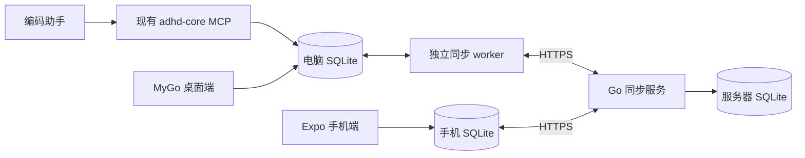

# M7：Android / iOS 独立客户端实施计划

日期：2026-10-16。代码基线：`6607f4751703588cbe99a47906561e8b99b9943a`（v0.2.0）。

状态：**Android 首版已实现，完整 M7 仍有后续阶段。** 云青已确认手机独立使用、离线编辑、多设备同步，以及 Expo / React Native 路线，并要求先交付 Android。[当前验证与剩余范围](m7-android-progress.md)单独记录。[调研与来源](m7-mobile-research.md)保留为技术依据；后续实施以本计划为准。

## 1. 已确定的路线与首版范围

| 项目 | 决定 |
| --- | --- |
| 手机端 | React Native + Expo development build；Android / iOS 共用 TypeScript 工程，pnpm 管理依赖 |
| 本地数据 | 每台设备独立 SQLite；界面先读写本地，离线编辑和待同步操作一起持久化 |
| 同步后端 | 独立 Go 服务 + 服务器 SQLite，部署在电脑之外；复用现有 domain，增加有限的业务同步协议 |
| 桌面端 | 继续使用 MyGo；保留本地数据库、CLI 和 stdio MCP，增加同步能力 |
| 用户模型 | 首版按单用户、多设备、一个服务实例规划；手机首次登录和绑定需要网络 |
| 提醒 | 已知提醒使用系统本地通知；远端推送用于提示，不承担数据同步保证 |
| 发布 | 首先交付 Android 签名测试 APK 和 iOS TestFlight；正式商店发布再走相应审核 |

首版交付：Mine / Agents、项目列表、任务详情、创建 / 编辑 / 完成 / 删除、子任务、到期日与基础日历、提醒、账户与设备、同步状态和冲突处理；中英文、明暗主题，沿用桌面的像素图标和文案语义。

完整看板、模型管理与图片问答、手机内嵌 Go、多人协作、通用 CRDT 放到后续。手机首版不需要这些能力才能离线管理任务；后续增加功能时仍遵循同一同步协议。

电脑关闭后，手机可以独立编辑和访问同步服务。Agent 停止后显示最后同步的报告；“电脑关闭但 GitHub 状态仍持续更新”涉及额外的服务器 GitHub 集成，放到后续功能阶段。

## 2. 交付完成的判断标准

1. Android 和 iPhone 都能安装实际构建，使用独立的应用标识、图标和版本号。
2. 首次同步后，断网仍可查看、新增、编辑和完成任务，创建父子任务；杀进程并重开后，数据和待同步操作都保留。
3. 网络恢复后，手机、桌面与服务器最终收敛；重试不重复创建，删除不会被离线设备无意恢复，冲突不会静默丢弃编辑。
4. 桌面和多个 MCP 进程产生的写入都能上传；手机编辑能回到电脑本地数据库，原有桌面功能保持可用。
5. 服务器离线、令牌过期、通知权限被拒绝时，本地任务管理仍可用，并显示准确的同步 / 提醒状态。
6. 已确认上传的数据能在新设备上恢复；数据库升级、备份恢复和旧客户端版本不兼容都有可验证的处理路径。

核心端到端场景：电脑关闭，手机 A 在飞行模式下新建父任务和子任务并修改状态，杀进程后重开；手机 B 同时编辑同一任务；A 恢复网络后，两台收敛，冲突有提示、用户编辑保留、报告不重复、删除不复活。

## 3. 模块与职责



| 位置 | 职责 | 实施阶段 |
| --- | --- | --- |
| `mobile/` | Expo 工程、导航、本地 SQLite、待同步队列、手机 UI、通知和安全凭据 | P0 起逐步增加 |
| `internal/syncproto/` | 有版本的数据与命令协议、错误类型、跨端样例 | P1 |
| `internal/sync/` | Go 端同步状态机、幂等处理、拉取与恢复；供客户端 worker / 服务端按职责调用 | P1–P3 |
| `internal/domain/`、`internal/store/` | 公共写事务、全局身份、操作捕获和迁移；继续维护现有业务规则 | P1–P3 |
| `cmd/adhd-sync/` | 独立服务器入口：认证、设备授权、push / pull / snapshot、持久化与运行配置 | P0 最小样例，P1 正式化 |
| `cmd/adhd-core/` | 增加独立的 `sync` worker 模式；MCP 继续通过原有 stdio 接口使用本地数据库 | P3 |
| `app/` | 桌面同步设置、状态与冲突入口；保留现有任务界面 | P3 |
| `.github/workflows/` | Go、手机端检查与构建；分发凭据只进入发布流程 | P4–P5 |

这些是按实际职责逐步创建的位置。P0 仅实现一条最小纵向路径，验证后再固定模块接口。

## 4. P0：构建就绪与最小同步闭环

目标：先证明“两个实际手机端离线操作后能恢复同步”，再扩展页面。

- 建立 `mobile/`，固定 Expo SDK / React Native 的兼容版本并提交 pnpm lockfile。使用 development build；加入 SQLite、SecureStore 和通知所需的官方模块。
- 建立任务列表和编辑小样，覆盖中文输入、键盘避让、导航返回和离线保存。使用临时数据库，不读取现有用户数据。
- 建立最小 Go 服务，完成单种任务的创建、更新、幂等确认和增量拉取。测试身份只允许用于本地 / 测试环境。
- 验证“任务编辑与待同步操作同事务”“丢回执后重试”“远端更新不覆盖本地待提交编辑”。
- 在 Android 和 iPhone 上完成安装、离线编辑、杀进程重开、恢复网络同步。模拟器构建可先完成，但不能替代这个阶段的真机结论。
- 确定后续正式服务的部署位置、持久化磁盘和身份提供商；正式登录按 OIDC 授权码 + PKCE、服务端令牌校验设计，账号供应商在本阶段落实。

验收：两台设备安装成功；断网 / 重开不丢数据；重复上传不产生重复任务；同一任务的版本冲突可见。记录构建版本、设备型号、系统版本、操作步骤和结果。

前置条件：本机需补齐完整 Xcode 与 Android 开发工具链，或采用已配置凭据的云构建。iOS 真机可使用适用的开发签名；TestFlight 在发布阶段需要 Apple Developer Program。没有真机或签名条件时，保留构建和自动化结果，把真机验收标为待完成。

## 5. P1：冻结协议并实现可靠同步

先完成协议文档和自动化故障测试，再把真实数据接入。P0 的临时实现只有通过这些约束后才能成为正式同步模块。

### 5.1 身份、版本与操作

- 项目、里程碑、任务、报告增加稳定的全局 `sync_id`，采用 UUID；保留现有本地整数主键，维护全局身份与本地外键映射。设备另有稳定 `device_id`。
- 每个操作有 `mutation_id`、协议版本、业务命令、受影响实体和预期服务端版本。重试沿用同一个操作 ID；同 ID 不同内容必须拒绝。
- 服务端为已提交变更分配单调序列，游标包含服务实例的 epoch 与序列。设备时间只表示业务时间，不能决定覆盖顺序或增量完整性。
- 本地确认快照与待提交操作分开保存。收到服务端快照后重放仍待提交的本地意图，不能用整行替换来抹掉未上传编辑。
- 项目、父任务、子任务、报告按依赖顺序提交；涉及多条记录的业务命令保持原子性，不能只同步一半。

### 5.2 三个数据接口

| 接口（拟议） | 约束 |
| --- | --- |
| `POST /v1/sync/push` | 每个业务操作原子执行；同事务保存业务变更、版本、日志和幂等回执；返回确认、冲突或可修复的拒绝原因 |
| `GET /v1/sync/pull` | 按服务端提交顺序返回；同一业务事务不能因分页被拆成半个可见结果；客户端同事务应用数据与推进游标 |
| `GET /v1/sync/snapshot` | 快照与其高水位游标对应同一一致性状态；分页不得混入不同时间点的数据；游标过期或 epoch 改变时支持重建 |

接口必须认证并验证设备授权。身份与设备管理另有最小接口，不把客户端提交的用户身份当作授权依据。

### 5.3 冲突、删除和恢复

- 首版使用乐观版本检查；同一记录出现不同版本时，保留本地操作与服务端数据，提供采用远端、保留本地后重新提交、继续编辑三个动作。重新提交仍要重新验证版本。
- 报告按稳定 ID 追加；Agent 的旧状态更新不能静默把用户已完成的任务改回进行中。先按版本冲突处理，不自动猜测用户意图。
- 删除写入 tombstone。删除项目 / 父任务等操作需要验证受影响集合与版本，防止离线删除覆盖其他设备刚创建或修改的子项；存在差异则返回冲突，不能部分删除。
- Undo 是新的显式恢复命令，有自己的操作 ID 和版本校验，不能删除历史 tombstone 来模拟恢复。
- 被冲突阻塞的操作及其依赖保留；其他无关任务可以继续同步，不能因队首一项冲突冻结整台设备。
- 首版暂不自动回收变更日志、tombstone 和幂等回执。后续压缩须同时定义最低可用游标、离线设备恢复与过期重试语义。

验收：自动化覆盖并发创建、乱序 / 重复请求、提交后丢回执、下载中断、进程崩溃、时钟偏差、父子依赖、并发编辑 / 删除 / 恢复、服务备份恢复和游标重建。所有场景检查数据库最终状态和用户编辑是否仍可恢复。

## 6. P2：完成手机核心功能

- 建立底部导航：Mine、Agents、项目与设置；任务详情使用手机页面 / sheet，避免照搬桌面多窗口。
- 实现项目列表、任务详情、离线 CRUD、完成 / 取消完成、子任务、优先级、到期日和基础日历。将当前领域语义整理为 Go / TypeScript 共用的协议样例，验证两端状态与空值处理一致。
- 显示本地保存、待同步、同步中、需登录、冲突等状态。服务不可用或令牌过期时继续允许离线编辑。
- 实现冲突入口，展示原编辑与远端内容；不以短暂 toast 作为用户找回编辑的唯一方式。
- 加入账户与设备页面、退出登录与设备撤销。退出前明确处理未上传操作；账户数据按账号隔离，凭据进入 SecureStore。
- 支持中英文、明暗模式、系统字体缩放和基本读屏标签；复用现有图标和文案资产，核对其许可证。

验收：新增、修改、删除与恢复都经过同一待同步队列；中文长文本、空值、父子任务、时区和无障碍基础有可记录的行为。真机 UI 验收独立于自动化检查记录。

## 7. P3：桌面、CLI / MCP 与旧数据库接入

- 在公共领域写事务中捕获变更，覆盖桌面、CLI 和所有 MCP 进程；业务写入与同步操作一起提交。远端应用路径显式区分，避免再次入队形成回声循环。
- 增加 `adhd-core sync` 独立 worker，允许由运行环境监督启动。每个本地数据库只运行一个上传 worker；进程退出后的锁和恢复行为需验证。
- MCP 进程只负责可靠写入本地，不因网络问题阻塞 Agent 调用。worker 独立于桌面窗口；关闭窗口不停止同步。进程未运行或电脑休眠时，操作保留，恢复运行后补传。
- 桌面加入同步地址、登录 / 设备绑定、最近成功同步、待上传数量和冲突入口。同步由用户明确启用；未启用时保持现有本地工作流。
- `cwd`、仓库绝对路径和 worktree 探测留在源设备。同步协议传项目身份、分支和 PR 信息，服务器不执行客户端路径对应的本地命令。
- 为旧数据库建立迁移与备份流程，回填稳定身份；协调桌面与 `adhd-core` 的 schema / 协议版本。旧客户端遇到不兼容版本时停止同步并提示升级。
- 首次导入指定一份现有数据库作为初始来源；其他有数据设备先提供合并预览与备份，再执行明确的导入策略，不按相同整数 ID 自动合并。新设备从服务器快照建立本地状态。

验收：多个 MCP 进程与桌面同时写入仍不漏操作；同步下载后原有 watcher 能通知 UI；手机与电脑都能离线修改、重开并恢复；旧数据库升级失败可恢复备份，恢复服务后客户端能识别 epoch 变化。

## 8. P4：提醒、生命周期与运行环境

- 本地提醒由系统通知 API 排程；修改 / 完成任务时替换或取消。投递记录按设备保存，不同步单个全局 `reminded_at` 来阻止其他设备通知。
- 远端变化可触发推送；推送仅引导拉取数据。启动、回前台和网络恢复时执行同步，后台任务尽力补充。
- 记录通知权限拒绝、精确提醒权限拒绝、设备重启、时区变化、飞行模式、锁屏、系统终止和用户强制退出的实际差异。
- 部署独立服务，配置 HTTPS、持久化存储、正式身份验证、设备撤销、备份与恢复。服务器日志不记录访问令牌和模型密钥。
- 自动化检查使用临时数据库、测试接口与故障注入验证结果；界面上显示的同步错误应能定位到具体设备与操作，便于处理失败。

验收：提醒不依赖 App 内常驻轮询；离线期间已过时的本地提醒在重新同步后撤销；服务重启和数据库恢复不丢已确认数据。后台即时性不作为无法兑现的保证。

## 9. P5：构建、分发和验收记录

- 固定应用 identifier、版本规则、Android keystore 与 iOS 签名管理方式；建立可复跑的 Android / iOS 构建说明或 CI。
- 发布 Android 签名 APK 供测试；准备 Play 所需 AAB。iOS 进入 TestFlight，记录内部 / 外部测试所需条件。
- 完成旧版本升级、数据库迁移、凭据失效、设备撤销、重新登录、新设备恢复和已确认数据恢复验证。未上传数据在卸载后无法承诺恢复，应在产品行为中明确。
- 整理商店所需的数据使用说明、截图、权限用途与账号删除路径；适用时完成 Play 封闭测试，再申请生产发布。
- 记录每个平台的构建来源、版本、签名 / 上传状态、自动化结果、真机 UI 结果与已知限制。未验证的项目保持待完成状态。

验收：Android 测试用户与 iOS TestFlight 测试用户都可实际安装并完成第 2 节场景。正式商店审核状态另记，生成安装文件不视为完成用户分发。

## 10. 建议的提交与检查顺序

| 变更包 | 内容 | 进入下一包的条件 |
| --- | --- | --- |
| 1 | Expo development build、临时任务与同步小样 | P0 结果明确，两端真机问题已记录 |
| 2 | 协议、全局身份、迁移与故障场景规格 | 操作、版本、删除和恢复语义固定 |
| 3 | Go 服务、事务日志、幂等回执、pull / snapshot | P1 故障测试通过 |
| 4 | 手机本地库、队列、重放和冲突处理 | 离线重开与双端收敛通过 |
| 5 | 手机业务页面、国际化与外观 | P2 功能及真机 UI 验收通过 |
| 6 | 公共写入捕获、worker、桌面状态与数据导入 | P3 多进程与迁移验证通过 |
| 7 | 通知、生命周期、服务部署与恢复 | P4 验收通过 |
| 8 | 双端分发、升级与验收记录 | P5 安装和数据恢复场景通过 |

每个变更包保持可单独审查；创建分支时使用 `codex/` 前缀。协议冻结后，手机页面与桌面接入可分别推进，端到端完成仍以共同验收为准。

实施时建立以下检查入口；这些是拟议的命令约定，本次没有创建工程或执行它们：

```sh
go test -race ./...
go vet ./...
go tool mygo i18n check app
pnpm --dir mobile typecheck
pnpm --dir mobile lint
pnpm --dir mobile test
```

Agent 负责自动化、API、数据库、构建和故障注入检查并提交结果。云青负责设备安装条件、必要账号操作与手动 UI 验收；不默认打开或操作浏览器。实际遇到账号、签名或工具链权限阻塞时，先完成可独立验证的部分，再说明具体缺项。

## 11. 工期、依赖与下一步

| 阶段 | 单名熟悉仓库的工程师粗估 | 主要依赖 |
| --- | --- | --- |
| P0 | 2–4 个工作日 | 构建工具、签名条件、Android / iPhone 真机 |
| P1 | 1.5–2.5 周 | P0 结果、身份方案、同步语义 |
| P2 | 1.5–2.5 周 | 协议、本地队列与同步模块 |
| P3 | 1–2 周 | 稳定协议、服务端接口与迁移规则 |
| P4–P5 | 1–2 周 | 常驻服务器、推送 / 签名账号、真机验收 |

总体暂按 **6–10 周**，在 P0 后校准；不是交付承诺，账号审核和商店等待另计。Apple Developer Program 官方为 99 USD / 年，Google Play 为 25 USD 一次性；账号是否已有、地区条件与 Play 测试要求在分发前核对，来源见调研报告。

当前已知准备项：完整 Xcode、本地 Android 工具链或可用云构建、两类真机、独立服务部署位置、正式身份提供商，以及发布阶段的开发者账号。未查询用户现有账号，也未安装工具、创建外部资源或修改真实数据库。

**当前 Android 首版已交付构建与模拟器验证，下一步是真机安装验收和独立同步服务部署；持续桌面复制、正式身份系统及 iOS 仍按后续阶段推进。** 具体结果和剩余范围见 [Android 交付记录](m7-android-progress.md)。
